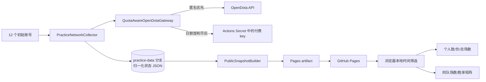

# OpenDota 练习赛闭包与 GitHub Pages 实施方案

> 状态：设计稿（2026-10-25，Asia/Tokyo）  
> 目标：不再依赖 Dota 2 GC，仅用 OpenDota 在可见范围内发现练习赛玩家闭包，并在 GitHub Pages 上提供时间筛选、个人战绩表和同队二维矩阵。

## 1. 结论

方案可行，推荐采用“GitHub Actions 采集 + Git 持久化状态 + 静态 Pages 展示”的结构：

- 初始种子固定为现有 12 个 Steam32 Account ID。
- 对每个已知玩家获取 OpenDota 可返回的全部练习赛历史；从比赛详情发现的所有非匿名玩家继续加入待扫描队列，直到本轮不再出现新玩家。
- 全局按 `match_id` 去重。每日任务仍重新枚举所有已知玩家的全部练习赛历史，以捕获 OpenDota 的延迟补录；已完整保存的比赛详情不重复下载。
- 每个请求先匿名调用免费 API。只有 OpenDota 明确返回“免费日额度耗尽”时，才切换到付费 Bearer key；分钟限流只等待重试。
- API key 只存在于本地 `.env` 和 GitHub Actions Secret，绝不进入 HTML、JavaScript、JSON、URL 或日志。
- Pages 只下载已归一化的静态 JSON，并在浏览器本地完成时间筛选和两张表的计算，因此拖动时间轴时不产生新 API 调用。

这里的“全量”严格指 **OpenDota 可见范围内的闭包**。付费 key 只能提高调用额度，无法解锁私密历史、匿名席位或 OpenDota 本身缺失的练习赛详情。

完整的官方依据与限制见 [OpenDota 与 GitHub Pages 调研](./opendota-github-pages-research.md)。

## 2. 已验证的现状

- 仓库：`BCSZSZ/dota2-mmr-reconstructor`，公开仓库，默认分支 `main`。
- 当前工具已同步到远端 `main`，提交为 `82bc380`。
- GitHub Pages 尚未启用，首次上线前需要在仓库 Settings → Pages 中将 Source 设为 **GitHub Actions**。
- 仓库已有被 `.gitignore` 排除的 `.env`，也已有只包含空值的 `.env.example`。实现阶段不得覆盖或读取真实 `.env`。
- 对当前 12 个账号的匿名 API 抽样证明：OpenDota 能返回部分 `lobby_type=1` 历史，抽样比赛详情包含 10 名可识别玩家和胜负结果，足以计算所需两张表。
- 当前 C# 练习赛客户端的 `less_than_match_id` 假设不能用于新任务：`/players/{account_id}/matches` 的正式分页参数是 `offset`。此外 `project` 必须使用重复查询参数，不能传逗号拼接字段。新采集器将独立实现，不复用这两处行为。

OpenDota 官方定义练习赛为 `lobby_type=1`；玩家历史还必须显式带 `significant=0`，否则会被默认的显著比赛过滤排除。玩家历史支持 `limit` 与 `offset`，比赛详情包含 `radiant_win`、`start_time`、`players[].account_id` 和 `player_slot`：[玩家历史参数](https://github.com/odota/core/blob/86e09304d7775540fd5e22e9a94d930034c4da09/svc/api/requests/playerParams.ts#L32-L103)、[练习赛常量](https://github.com/odota/dotaconstants/blob/5c0242df9057848fa2036ca3fafe9f2bd4508163/build/lobby_type.json#L6-L10)、[比赛详情 schema](https://github.com/odota/core/blob/86e09304d7775540fd5e22e9a94d930034c4da09/svc/api/responses/MatchResponse.ts#L89-L180)。

## 3. 总体架构



最重要的边界是归一化状态 JSON：采集端可以变化分页、限流或重试实现，网页端只依赖稳定的数据 schema；网页完全不知道 OpenDota key 和网络采集细节。

## 4. 模块与接口

为了让每个模块承担较多复杂度而暴露较小接口，建议分为以下四个深模块。

### 4.1 `QuotaAwareOpenDotaGateway`

职责：隐藏 HTTP、匿名/付费切换、分页、节流、重试和 OpenDota 字段差异。

对上只暴露：

```text
list_all_practice_match_refs(account_id) -> HistoryResult
get_practice_match(match_id)            -> MatchResult
run_usage()                              -> UsageSummary
```

实现要点：

- 历史请求固定带 `lobby_type=1&significant=0`。
- 使用 `limit=500&offset=N`，空页或短页结束；全程按 `match_id` 再去重。
- 如果限制返回字段，发送重复的 `project=match_id&project=start_time&project=lobby_type`，不用逗号拼接。
- 详情再次校验 `lobby_type===1`，拒绝把脏数据加入统计。
- 只通过 `Authorization: Bearer ...` 发送 key，不使用 URL 参数。

### 4.2 `PracticeNetworkCollector`

职责：实现玩家—比赛图的固定点遍历；不关心 HTTP 和额度细节。

核心接口：

```text
refresh(previous_state, initial_seeds, safety_policy) -> RefreshOutcome
```

`RefreshOutcome` 必须明确区分 `complete`、`checkpointed`、`failed`，防止达到保险阀后仍把部分结果冒充完整结果发布。

### 4.3 `PublicSnapshotBuilder`

职责：从采集状态生成浏览器所需的最小公开数据，不复制 OpenDota 原始响应。

输出只保留：账号 ID、显示名、比赛 ID、开始时间、胜方、双方已识别玩家、覆盖和缺失诊断。API key、HTTP header、错误正文和内部重试信息一律不进入快照。

### 4.4 前端 `StatisticsEngine`

职责：输入公开快照和 JST 时间半开区间，输出两张表；它是纯函数模块，可直接用固定 fixture 测试。

```text
summarize_players(snapshot, range) -> PlayerRow[]
build_teammate_matrix(snapshot, range) -> Matrix
```

## 5. 采集算法

### 5.1 首次部署

初始队列为下列 12 个 Steam32 Account ID：

```text
274556888, 136619313, 1130047837, 193915131,
292823960, 301344612, 255076729, 1098196409,
1068845781, 140721966, 372120492, 883819932
```

固定点算法：

```text
known_players = initial_seeds
queue = initial_seeds
known_matches = previously persisted matches

while queue is not empty:
    account_id = queue.pop()
    refs = list_all_practice_match_refs(account_id)

    for match_id in refs:
        if complete detail is not already persisted:
            detail = get_practice_match(match_id)
            persist detail or a retryable diagnostic

        for every positive, non-anonymous account_id on both teams:
            if account_id is new:
                add it to known_players and queue

publish only after queue reaches an empty fixed point
```

所有玩家都加入闭包，不只加入种子玩家的队友。这样即使最初 12 人并非每场都到齐，也能通过同一场中出现的其他成员继续找到他们的练习赛。

### 5.2 每日刷新

这个圈子规模小，推荐每天对 **所有已知玩家重新枚举全部可见练习赛历史**，而不是仅依赖最近日期窗口：

- 玩家历史通常每人只需少量分页请求；
- 历史 `match_id` 全局去重；
- 已有完整详情不重复调用 `/matches/{match_id}`；
- 新发现比赛才取详情，新发现玩家立即做完整历史扫描；
- 曾经缺失的详情按退避策略重试，能够接住 OpenDota 延迟补录的旧比赛。

这比保存不稳定的 offset 游标更可靠，也最贴合“每个种子取 OpenDota 可提供的最大历史”的要求。

### 5.3 保险阀

即使预期只有内部对黑，也必须防止误连到更大的玩家网络：

| 保险阀 | 建议默认值 | 达到后的行为 |
|---|---:|---|
| `MAX_DISCOVERED_PLAYERS` | 250 | 保存断点，不发布新的完整快照 |
| `MAX_MATCHES` | 20,000 | 保存断点并失败 |
| `MAX_API_CALLS_PER_RUN` | 20,000 | 保存断点并失败 |
| `OPENDOTA_MAX_PAID_CALLS` | 3,000 | 停止付费调用，保留上一版已发布页面 |

这些值均放在采集配置中，可后续调整；触发原因必须显示在 Actions 摘要中。

## 6. 免费优先、付费兜底

状态机如下：

1. 每个请求第一次都不带 key，匿名速率保守控制在 45 次/分钟左右。
2. 2xx 时读取 `X-Rate-Limit-Remaining-Minute` 和匿名请求才有的 `X-Rate-Limit-Remaining-Day`。
3. `minute rate limit exceeded`：等待下一分钟边界并加抖动，然后继续匿名请求。
4. 只有 `daily api limit exceeded`，或响应明确表明日剩余额度为 0，才切换到付费 key，并在该次运行剩余阶段保持付费模式。
5. 未配置 key 时，保存断点、保留上一份完整页面并令采集 job 明确失败；不发布部分闭包。
6. 5xx、网络错误、404 或无法分类的 429 采用退避/失败策略，不能通过付费 key 掩盖。
7. 日志只记录匿名调用数、付费调用数和切换原因，不记录 Authorization header。

OpenDota 当前生产元数据显示匿名额度为 3,000/日、60/分钟，有 key 为 3,000/分钟；数值可能由部署配置改变，所以运行时以 metadata、响应头和 429 正文为准：[生产 metadata](https://api.opendota.com/api/metadata)、[限流实现](https://github.com/odota/core/blob/86e09304d7775540fd5e22e9a94d930034c4da09/svc/web.ts#L413-L507)。

## 7. 持久化数据

推荐新建专用 `practice-data` 分支，只保存规范化状态，避免每日刷新提交污染 `main` 历史。工作流在独立目录检出该分支，刷新后仅在内容变化时提交，然后使用刚生成的数据构建 Pages；不依赖下一次 push 触发。

建议 schema：

```json
{
  "schema_version": 1,
  "collection": {
    "status": "complete",
    "last_success_at": "2026-10-25T01:07:00Z",
    "anonymous_calls": 42,
    "paid_calls": 0,
    "earliest_match_time": 0,
    "latest_match_time": 0,
    "unresolved_match_count": 0,
    "anonymous_slot_count": 0
  },
  "players": {
    "136619313": {
      "display_name": "WC.BCSZSZ",
      "scan_status": "complete"
    }
  },
  "matches": {
    "8993543199": {
      "start_time": 0,
      "radiant_win": true,
      "players": [
        { "account_id": 136619313, "side": "radiant" }
      ]
    }
  },
  "unresolved_matches": {}
}
```

显示名采用“种子别名优先、其后为最近一次比赛详情中的非空名称、最后退回 Account ID”的规则。原始 OpenDota JSON 不持久化。

## 8. 网页交互

### 8.1 时间选择器

页面顶部使用单一时间轴：

- 轴背景绘制每日比赛密度柱，用户能看到比赛集中在哪些日期；
- 两个可拖动手柄选择起止日；选区本身也可整体拖动；
- 两个 `date` 输入框与手柄双向同步，支持精确手工输入；
- 快捷按钮：`过去 3 天`、`过去 7 天`、`过去 1 个月`、`全部`；
- URL 写入 `?from=YYYY-MM-DD&to=YYYY-MM-DD`，刷新或分享链接时保留选择；
- 全部日期按 JST 解释为 `[起始日 00:00, 结束日次日 00:00)`，避免末日比赛被漏掉。

“过去 3 天/7 天”定义为包含今天的 3/7 个 JST 自然日；“过去 1 个月”定义为从 JST 当前日期向前减一个日历月到今天结束。

### 8.2 第一张表：个人战绩

默认按总场数降序，再按显示名排序：

| 玩家 | Account ID | 胜 | 负 | 总场数 | 胜率 |
|---|---:|---:|---:|---:|---:|

每场只为详情中可识别、实际参赛的账号计数；没有参加某场的人不会受到影响。

### 8.3 第二张表：同队二维矩阵

- 行列使用同一玩家顺序，矩阵对称。
- 只统计两人在同一队的比赛；对手关系不进入该格。
- 单元格只显示 `共同场数/同队胜率`，例如 `3/66.7%`。
- 无共同场留空；对角线显示 `—`；一场也照常显示，例如 `1/100%`。
- 胜率用浅红—中性—浅绿背景辅助浏览，但文字始终是权威值。
- 固定首行首列，人数较多时横向滚动；可切换“只显示所选时间内参赛者”。

计算规则：对所选时间内的每场比赛，先给每名可识别玩家累计个人胜负，再按同队玩家生成无序二元组合；同一组合的计数同时写入矩阵两侧。

页面页眉同时显示：最后成功刷新时间、OpenDota 可见的最早/最晚比赛、已知玩家数、比赛数、匿名席位数、缺失详情数，以及“OpenDota 可见范围，并非 Valve 全量”的提示。

## 9. GitHub Actions 与 Pages

建议单个工作流 `.github/workflows/practice-site.yml`，包含三个串行 job：

1. `collect`：读取 `practice-data`，运行闭包采集，提交更新；权限 `contents: write`。
2. `build`：从刚生成的状态构建静态站点与公开快照，上传 Pages artifact；权限 `contents: read`。
3. `deploy`：部署 Pages；权限 `pages: write`、`id-token: write`，环境 `github-pages`。

触发方式：

```yaml
on:
  workflow_dispatch:
    inputs:
      full_refresh:
        type: boolean
        default: false
  schedule:
    - cron: "7 1 * * *" # 每日 10:07 JST
```

选择 10:07 而非 10:00，是为了避开 GitHub 官方提示的整点调度高峰；它仍属于用户要求的 JST 上午 10 点时段。schedule 是计划触发而不是准点 SLA，可能延迟：[GitHub schedule 规则](https://docs.github.com/en/actions/reference/workflows-and-actions/events-that-trigger-workflows#schedule)。

其他要求：

- `concurrency` 使用固定 group，`cancel-in-progress: false`，避免手动和定时任务同时写状态。
- 首次无数据时，手动任务自动执行完整闭包；之后每日同样枚举全部历史，但复用已有详情。
- 提供 `full_refresh` 手动选项，用于丢弃扫描完成标记并重新核对，而不是删除已知数据。
- 用 `GITHUB_TOKEN` 推送数据不会递归触发新的 workflow；当前运行直接继续 build/deploy。[GitHub 防递归说明](https://docs.github.com/en/actions/how-tos/write-workflows/choose-when-workflows-run/trigger-a-workflow#triggering-a-workflow-from-a-workflow)
- Pages 按官方 `configure-pages` → `upload-pages-artifact` → `deploy-pages` 链路部署：[自定义 Pages workflow](https://docs.github.com/en/pages/getting-started-with-github-pages/using-custom-workflows-with-github-pages)。

预期地址：`https://bcszsz.github.io/dota2-mmr-reconstructor/`。

## 10. key 配置

### 本地

仓库目前已有被忽略的 `.env`，实现时只需要用户在其中填入：

```dotenv
OPENDOTA_API_KEY=
OPENDOTA_MAX_PAID_CALLS=3000
```

`.env.example` 会同步补充同样的变量名和说明，但永远不含真实值。采集器在 key 为空时正常以免费模式运行。

### GitHub

在仓库 Settings → Secrets and variables → Actions 中创建 repository secret：

```text
OPENDOTA_API_KEY
```

可把 `OPENDOTA_MAX_PAID_CALLS` 设为普通 repository variable。Secret 只注入 `collect` step，`build` 与 `deploy` 不接触它。GitHub 官方也建议使用 Actions secrets，而不是把凭据写入 workflow 或代码：[GitHub Secrets](https://docs.github.com/en/actions/concepts/security/secrets)。

## 11. 测试与验收

### 自动测试

- 图闭包：从 12 个种子发现新玩家并继续扫描，队列最终收敛。
- 去重：多个玩家历史包含同一 `match_id` 时只取一次详情。
- 分页：offset 的空页/短页结束、页边界重复以及新比赛插入都不会重复统计。
- 限额：分钟 429 等待；日额度 429 才切付费；5xx 不切付费；付费上限可中止并保存断点。
- 时间：JST 跨日、月底和夏令时无关场景；结束日包含全天。
- 统计：个人胜负守恒；矩阵对称；一场比赛显示 `1/0%` 或 `1/100%`；三场两胜显示 `3/66.7%`。
- 安全：生成目录与日志中搜索不到 API key。
- 前端：双手柄、手工日期、快捷按钮和 URL 参数保持一致。

### 上线验收

1. 首次手动 workflow 从 12 人出发，达到固定点并报告玩家/比赛/缺失数量。
2. 随机抽 3 场比赛，网页个人胜负和同队组合与 OpenDota 详情一致。
3. 选择现有 Excel 的同一时间范围，核对两张表；允许的差异只能来自已声明的 OpenDota 覆盖缺口。
4. Actions 日志、Pages 产物和 `practice-data` 分支均不含 key。
5. 第二次无新增数据运行不重复比赛，统计不漂移。

## 12. 实施顺序

1. **采集核心**：独立 Python collector、状态 schema、fixture 和闭包/额度测试。
2. **静态网页**：时间轴、日期输入、快捷按钮、两张表和覆盖诊断。
3. **GitHub 集成**：`practice-data` 分支、Actions secret、手动 bootstrap、Pages 部署。
4. **自动刷新**：确认首次结果后开启每日 10:07 JST schedule。
5. **对账**：用当前 Excel 时间范围核验，记录 OpenDota 与 GC 旧结果的覆盖差异。

仓库已经具备 Python 3.12、`uv`、`httpx`、`python-dotenv` 和 pytest 基础，因此推荐沿用 Python 实现采集与构建，不把 Windows/WinForms collector 带入 Linux Actions。现有桌面 GC 功能可以保留作历史工具，但新网页路径不调用 GC，也不依赖它的输出。

## 13. 上线前唯一必须确认的产品边界

GitHub Pages 和当前仓库都是公开的，因此显示名、Account ID、比赛时间、比赛 ID 和组队关系会被任何知道网址的人访问。实现可以按以下默认方案推进：公开显示现有名字和 Account ID；如果不接受，则必须在发布前改为固定化名并从公开快照移除 Account ID/比赛 ID。
